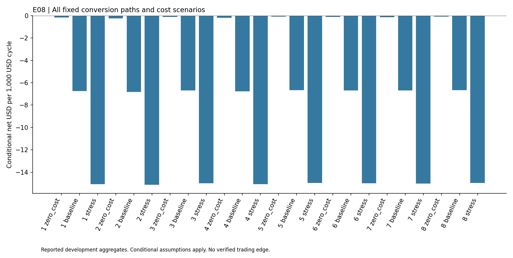

# Stablecoin Conversion Loops

## Findings

This study checked whether a sequence of stablecoin conversions could return more USD than it started with after visible prices, order constraints and assumed costs. The initial pilot was followed by a fixed extension containing eight conversion directions.

Every direction in the extension had a negative conditional margin even with zero costs. The 24 direction and cost scenario combinations were negative. Quote timing and age checks also failed, so none was execution qualified.

The result does not demonstrate an available conversion trade. It rejects the captured combinations under the recorded assumptions, while leaving the wider question of stablecoin market efficiency open.

## Reading this report

This public copy contains the findings of one completed development study. Its chart uses only the small aggregate table in [findings.json](findings.json). The original research history, raw observations, source datasets and reserved confirmation periods remain private. This copy does not reproduce a historical backtest or establish an independently confirmed strategy.

Install matplotlib in your own Python environment, then run `python plot_results.py` to regenerate the chart. The script reads the saved table and makes no network requests. These are reported findings from the original study, not a fresh evaluation. Passing an integrity check or reproducing this chart does not validate profitability.

The [public file manifest](PUBLIC_FILES.json) records hashes of the report, aggregate table, chart script and figure. This copy was prepared without the original Git history so personal commit email addresses are not exposed. It grants no rights to underlying third-party datasets.
